# Art PCB Gallery | 艺术纪念电路板作品集

一组面向 **嘉立创 EDA 专业版（EasyEDA Pro）** 的二次元与游戏道具主题艺术 PCB 工程合集，共包含 **9 组作品、13 份 `.epro2` 工程文件**。

涵盖 **常规阻焊 + 白色丝印 + 局部沉金**（部分设计参考了免费沉金券 ≤ 20% 露金规则）、**白油全彩丝印 + 局部真金点缀**，以及 **纯矢量几何绘图 + 阻焊下隐藏铜皮暗纹** 三种工艺路线。

> [!WARNING]
> **未实物打样声明 / Physical Fabrication Disclaimer**
> 本仓库中的所有工程均**仅在嘉立创 EDA 专业版中完成设计与导出检查，作者尚未实际下单制作实物**。文中展示的图片均为设计渲染预览效果，**并非实物照片**；实际打板成品的彩印色彩偏差、暗纹清晰度、沉金光泽、最细线宽/细节表现，以及板厂工程审核与优惠券结算结果，均可能与预览图存在差异。**如需下单打样，请务必自行在嘉立创 EDA 及下单界面仔细复核 2D/3D 预览、DRC 与工艺规范，由此产生的打样风险与费用由下单者自行承担。**

> **二创版权与非商用声明 / Non-Commercial Fan-Art Notice**
> 本仓库收录作品灵感源自《原神》（miHoYo / HoYoverse）与《三角洲行动》（Team Jade / Tencent）角色及游戏道具设定，相关原型角色、名称与商标版权归原版权方所有。所有工程均为**非官方同人纪念设计**，遵循 [CC BY-NC-SA 4.0](LICENSE) 协议开源，**仅限个人学习、交流与自费 DIY 打样收藏，严禁任何形式的商业生产与贩售**。

---

## 快速上手（导入与预览指南）

### 1. 导入工程
1. 下载本仓库中任意 `.epro2` 文件。
2. 打开 **嘉立创 EDA 专业版（v4.1.99 及以上）** → `文件` → `打开` → `嘉立创EDA工程`，或直接将 `.epro2` 拖入客户端打开。
3. 本仓库内 `.epro2` 已预设好背面方向与图层对应关系，**无需手动镜像背面**，可在软件内自行运行 DRC、检查 2D/3D 效果并导出 Gerber。

### 2. 彩印版在 2D/3D 预览看到“蓝色基板”怎么办？
以下 **8 份彩色丝印工程** 在保存状态下默认 3D 外观属性为蓝色阻焊 + 标准丝印，打开后如果看到蓝板或看不到彩色图案，请按如下方式切换预览：
- 在右侧属性面板中，将 **丝印工艺** 切换为 **`彩色丝印`**
- **阻焊颜色** 选择 **`白色`**
- **表面处理** 选择 **`沉金`**

> 下单时请务必保留导出 Gerber 包中的 `FCTS`、`FCBS`、`FCBO`、`FCBM` 彩色丝印专用文件（普通第三方 Gerber 查看器通常无法显示彩印图层），并按嘉立创彩色丝印工艺计价下单。

### 3. 常规沉金免费券提示（≤ 20% 露金）
如果您希望尽量使用嘉立创 **2–4 层沉金 EDA 专用券**，请优先选择以下工程（常规双层 FR-4、**黑色阻焊、白色常规丝印、沉金**、5 片、单片出货）：
- `02` [钟离与摩拉克斯（常规沉金券版）](boards/02-zhongli-morax/enig-coupon/Zhongli-Morax-ENIG-Coupon.epro2)：实测两面总面积露金 **17.80%**（正面 17.74%，背面 17.86%）
- `03` [宵宫-夏祭花火（常规沉金券版）](boards/03-yoimiya-fireworks/enig-coupon/Yoimiya-Fireworks-ENIG-Coupon.epro2)：实测两面总面积露金 **17.64%**（正面 19.14%，背面 16.15%）

> 具体用券资格与实付金额请以嘉立创账户结算页及最新工艺规则为准（[领券规则](https://www.jlc.com/coupons) / [打样规范](https://www.jlc.com/portal/q7i37595.html) / [彩色丝印说明](https://prodocs.lceda.cn/cn/pcb/other-draw-colorful-silkscreen/index.html)）。

---

## 作品总表与工程下载

| 编号 | 作品名称 | 尺寸 (mm) | 推荐工艺 / 板色 | 露金情况 | 工程文件 (`.epro2`) |
| :---: | :--- | :--- | :--- | :--- | :--- |
| `01` | 雷电将军收藏卡 | `54.00 × 86.00` | 紫油 · 白字 · 沉金 | — | [Raiden-Shogun-ENIG-Card.epro2](boards/01-raiden-enig-card/Raiden-Shogun-ENIG-Card.epro2) |
| `02-A` | 钟离与摩拉克斯 · 岩星（常规沉金券版） | `95.00 × 95.00` | 黑油 · 白字 · 沉金（适合沉金券） | 双面总计 `17.80%` | [Zhongli-Morax-ENIG-Coupon.epro2](boards/02-zhongli-morax/enig-coupon/Zhongli-Morax-ENIG-Coupon.epro2) |
| `02-B` | 钟离与摩拉克斯 · 岩星（朱红彩印版） | `95.00 × 95.00` | 白油 · 双面彩色丝印 · 局部沉金 | 双面总计 `2.44%` | [Zhongli-Morax-Color-Silk.epro2](boards/02-zhongli-morax/color-silk/Zhongli-Morax-Color-Silk.epro2) |
| `03-A` | 宵宫 · 夏祭花火（常规沉金券版） | `95.00 × 95.00` | 黑油 · 白字 · 沉金（适合沉金券） | 双面总计 `17.64%` | [Yoimiya-Fireworks-ENIG-Coupon.epro2](boards/03-yoimiya-fireworks/enig-coupon/Yoimiya-Fireworks-ENIG-Coupon.epro2) |
| `03-B` | 宵宫 · 夏祭花火（朱红彩印版） | `95.00 × 95.00` | 白油 · 双面彩色丝印 · 局部沉金 | 双面总计 `0.82%` | [Yoimiya-Fireworks-Color-Silk.epro2](boards/03-yoimiya-fireworks/color-silk/Yoimiya-Fireworks-Color-Silk.epro2) |
| `04-A` | 旅行者双子 · 空（晨星纪念板） | `95.00 × 95.00` | 白油 · 双面彩色丝印 · 局部沉金 | 正 `0.34%` / 背 `0.18%` | [Aether-Morningstar.epro2](boards/04-traveler-twins/Aether-Morningstar.epro2) |
| `04-B` | 旅行者双子 · 荧（月华纪念板） | `95.00 × 95.00` | 白油 · 双面彩色丝印 · 局部沉金 | 正 `0.12%` / 背 `0.13%` | [Lumine-Moonlight.epro2](boards/04-traveler-twins/Lumine-Moonlight.epro2) |
| `05` | 雷电将军 · 梦想一心 | `95.00 × 95.00` | 白油 · 双面彩色丝印 · 局部沉金 | 正 `0.38%` / 背 `0.17%` | [Raiden-Shogun-Musou-Isshin.epro2](boards/05-raiden-musou-isshin/Raiden-Shogun-Musou-Isshin.epro2) |
| `06` | 芙宁娜 · 终幕致意 | `95.00 × 95.00` | 白油 · 双面彩色丝印 · 局部沉金 | 正 `0.22%` / 背 `0.10%` | [Furina-Curtain-Call.epro2](boards/06-furina-curtain-call/Furina-Curtain-Call.epro2) |
| `07` | 哥伦比娅 · 月下低吟 | `95.00 × 95.00` | 白油 · 双面彩色丝印 · 局部沉金 | 正 `0.13%` / 背 `0.02%` | [Columbina-Moonlight.epro2](boards/07-columbina-moonlight/Columbina-Moonlight.epro2) |
| `08` | 冰之女皇 · 霜冠落子 | `95.00 × 95.00` | 白油 · 双面彩色丝印 · 局部沉金 | 正 `0.06%` / 背 `0.006%` | [Tsaritsa-Frost-Crown.epro2](boards/08-tsaritsa-frost-crown/Tsaritsa-Frost-Crown.epro2) |
| `09-A` | 三角洲行动 · 变电站技术室（标准白卡） | `85.60 × 53.98` | 黑油 · 大面积白字 · 局部沉金 | — | [Delta-Substation-Keycard-White.epro2](boards/09-delta-force-substation-keycard/standard-white/Delta-Substation-Keycard-White.epro2) |
| `09-B` | 三角洲行动 · 变电站技术室（高阶红卡版） | `85.60 × 53.98` | 双层 1.0 mm · 黑油或红油 · 沉金（含隐藏铜皮暗纹） | — | [Delta-Substation-Keycard-RedCard.epro2](boards/09-delta-force-substation-keycard/redcard-edition/Delta-Substation-Keycard-RedCard.epro2) |

---

## 效果画廊 / Preview Gallery

### 01 · 雷电将军收藏卡 (`54 × 86 mm`)
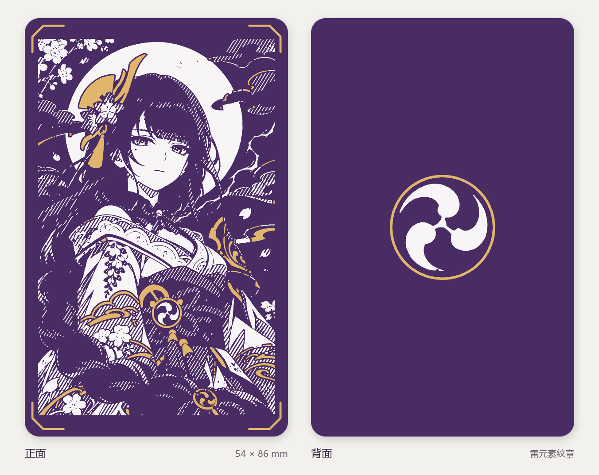

### 02 · 钟离与摩拉克斯 · 岩星纪念板 (`95 × 95 mm`)
- **常规沉金券版**（黑油白字沉金，双面总露金 `17.80%`）：
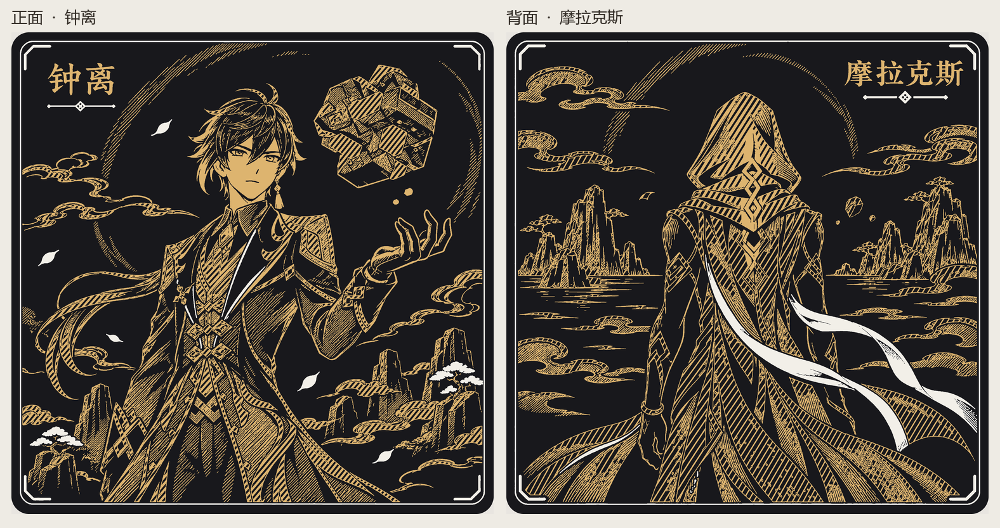

- **朱红彩印版**（白油彩印 + 岩星/兜帽局部沉金，双面总露金 `2.44%`）：
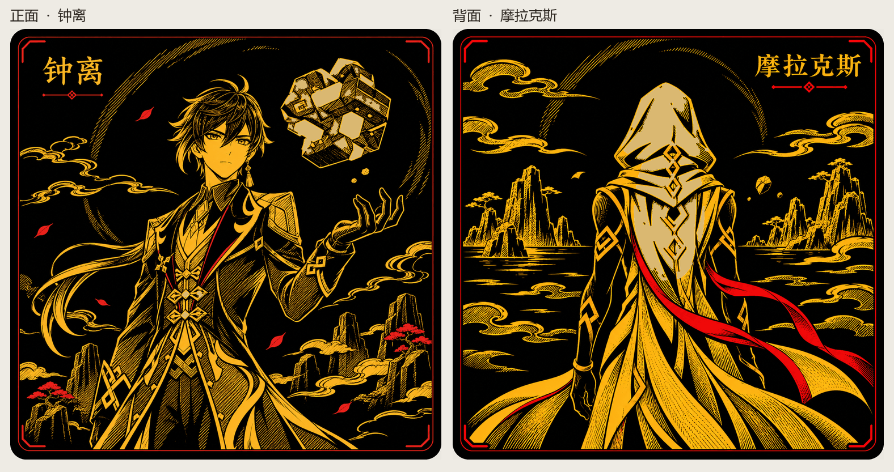

### 03 · 宵宫 · 夏祭花火纪念板 (`95 × 95 mm`)
- **常规沉金券版**（黑油白字沉金，双面总露金 `17.64%`）：
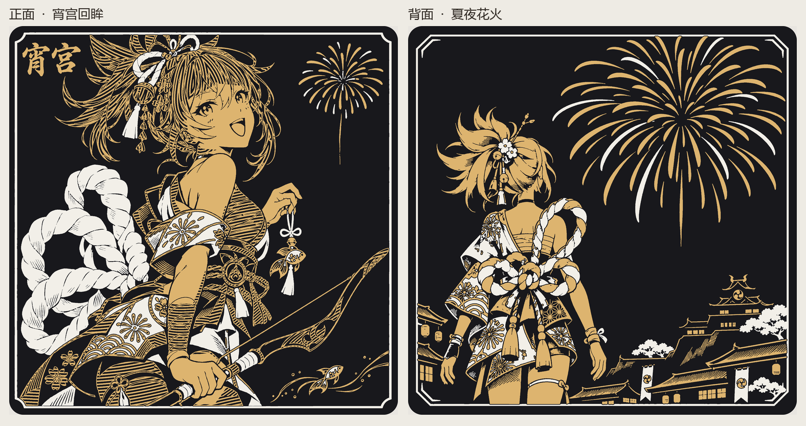

- **朱红彩印版**（白油彩印 + 金鱼发饰/烟花局部沉金，双面总露金 `0.82%`）：
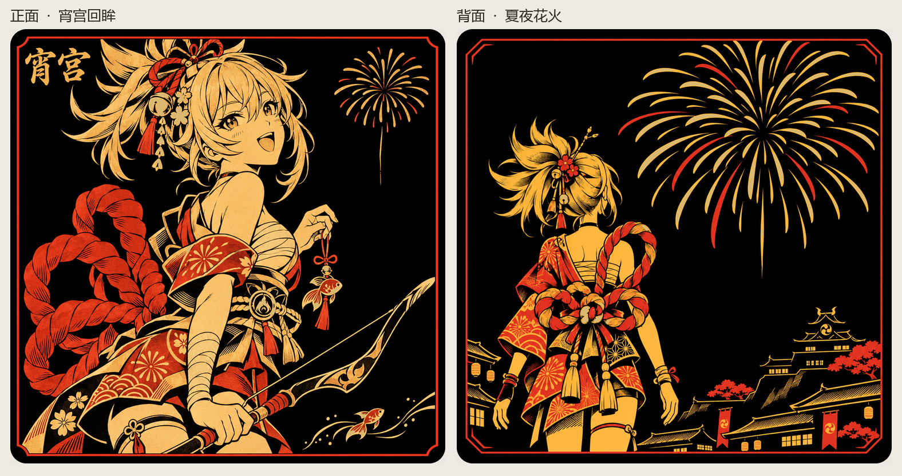

### 04 · 旅行者双子纪念板（空-晨星 / 荧-月华，`95 × 95 mm`）
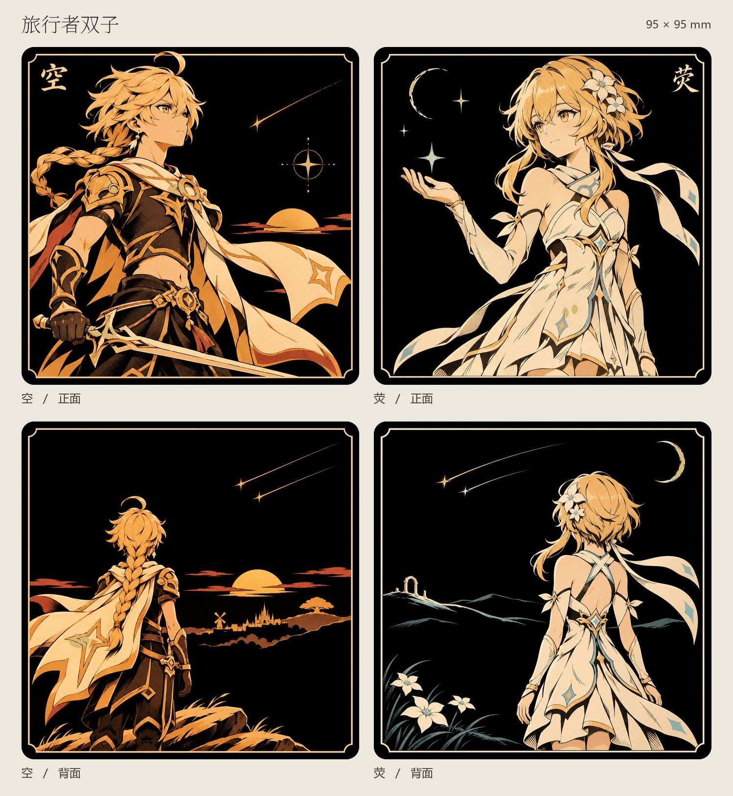

### 05 · 雷电将军 · 梦想一心 (`95 × 95 mm`)
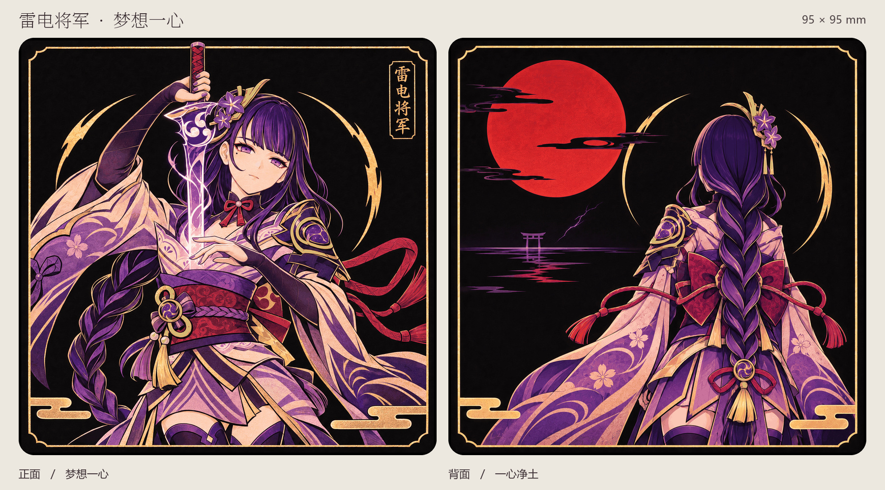

### 06 · 芙宁娜 · 终幕致意 (`95 × 95 mm`)
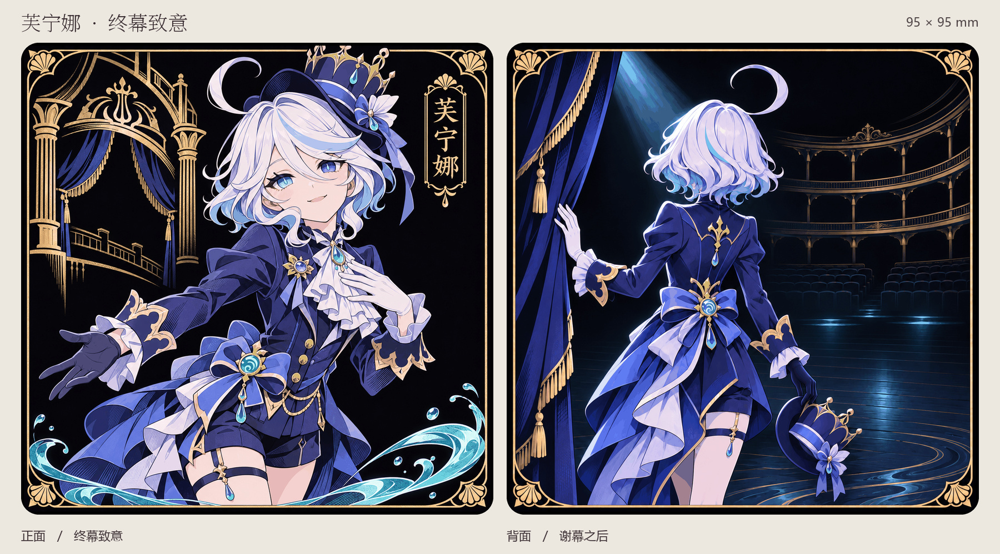

### 07 · 哥伦比娅 · 月下低吟 (`95 × 95 mm`)
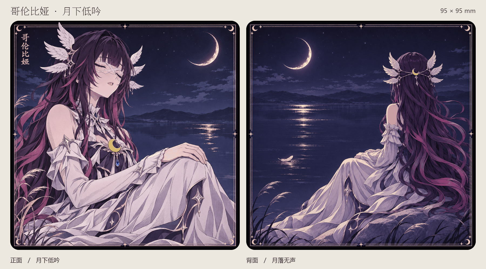

### 08 · 冰之女皇 · 霜冠落子 (`95 × 95 mm`)
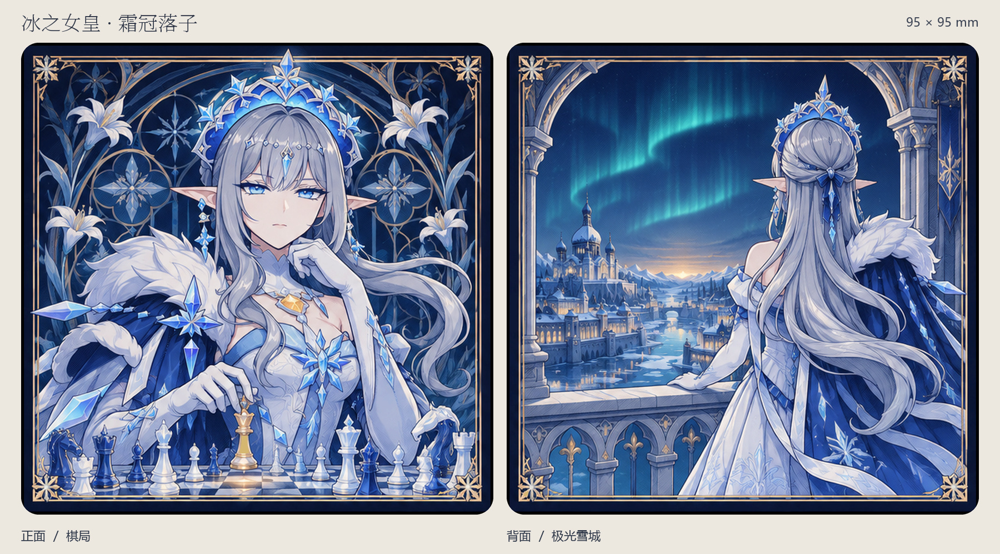

### 09 · 三角洲行动 · 零号大坝 变电站技术室房卡 (`85.60 × 53.98 mm`)
- **标准版（黑油白字局部沉金）**：
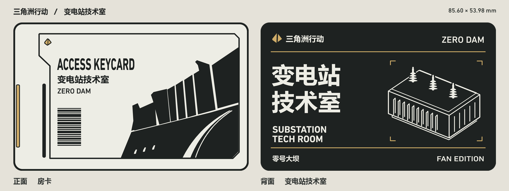

- **高阶红卡版（支持 1.0 mm 黑色阻焊黑金 / 红色阻焊红金，含阻焊下隐藏铜皮暗纹）**：
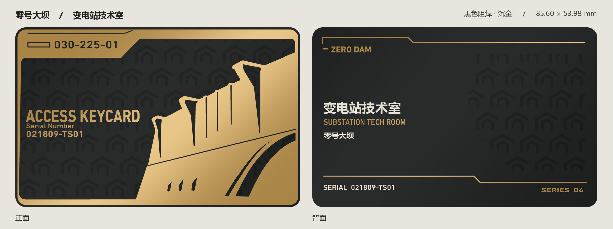
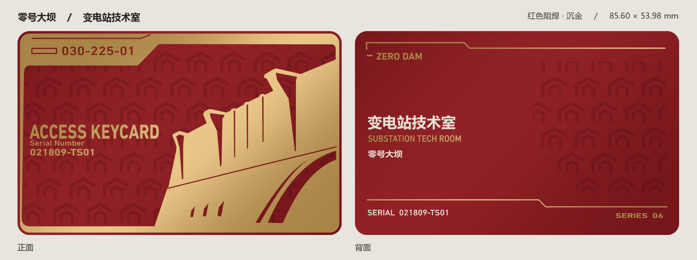
